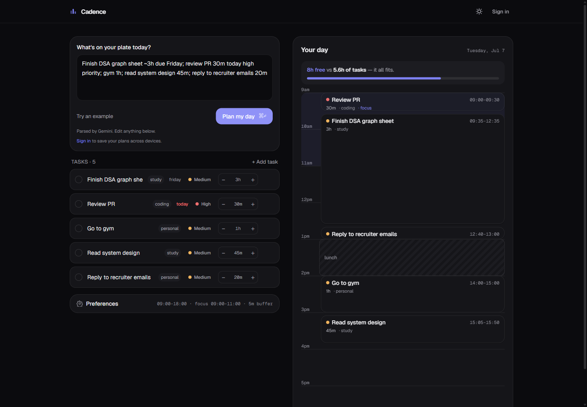
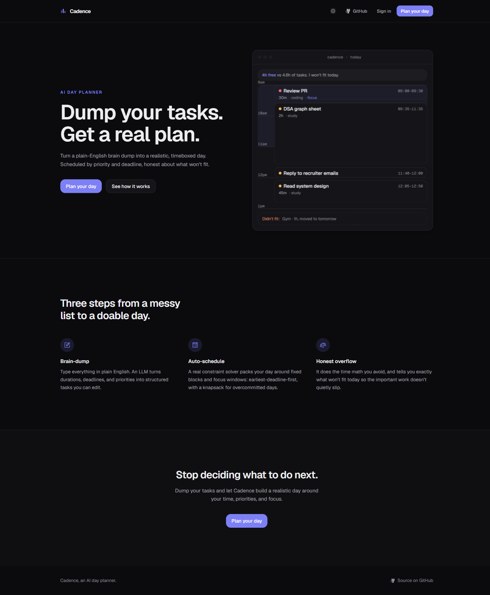
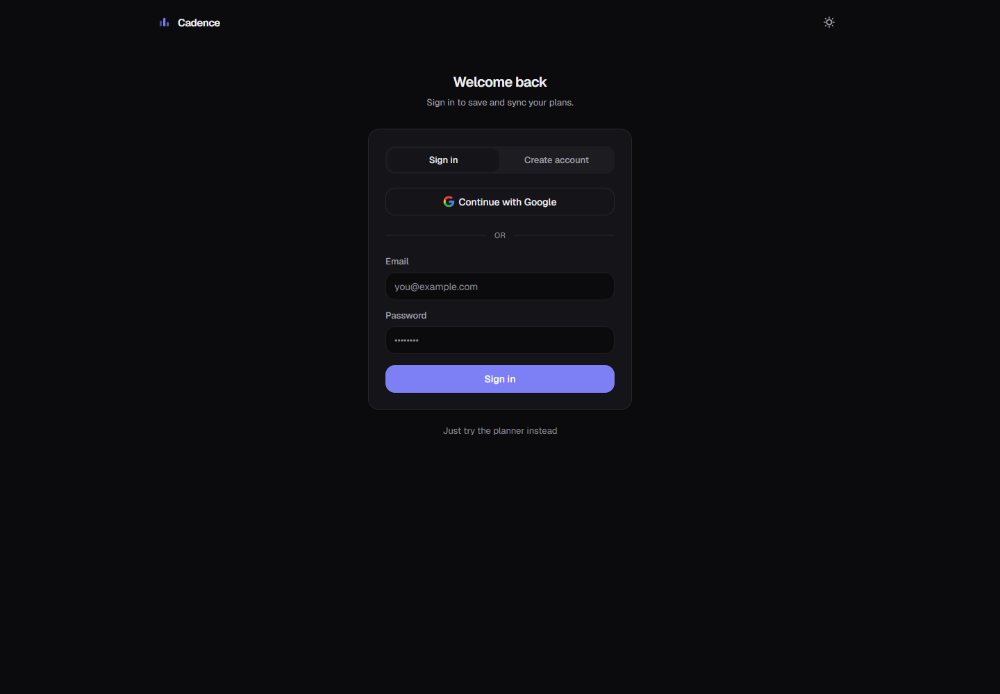

# Cadence

> An AI day planner that auto-schedules your tasks by priority, deadline, and focus windows.

**[Live demo → cadenceday.vercel.app](https://cadenceday.vercel.app)**  ·  Next.js · TypeScript · Supabase · Gemini

Cadence turns a plain-English brain-dump into a realistic, timeboxed day. **AI reads your
tasks and works out each one's priority, time estimate, deadline, and category**, then a
constraint-based scheduling engine packs them into your real available time and honestly
tells you what won't fit.



## What it does

Type `"finish DSA sheet ~3h due Friday; review PR 30m today high priority; gym 1h"` and Cadence:

1. **Understands it with AI.** Gemini interprets your natural language and decides each
   task's priority, time estimate, deadline, and category.
2. **Builds your day.** The scheduling engine places every task around your work hours,
   fixed blocks, and focus windows, with buffers between them.
3. **Is honest about overflow.** It does the time math you avoid: *"5.5h free vs 7h of
   tasks. 2 won't fit today,"* and moves the rest to tomorrow.

Edit any task, tweak your work hours / focus window / buffers, and the plan re-packs live.
Sign in with email or Google and your tasks and plan persist across devices.

## Screens

The planner adapts to light and dark, and works on mobile.

**Landing**



**Sign in** (email/password or Google)



## Under the hood: the scheduling engine

The general problem (durations + deadlines + priorities + fixed blocks + dependencies) is
NP-hard, so the engine composes specific, named algorithms and states the trade-offs:

| Sub-problem | Approach |
|---|---|
| Minimize lateness | **Earliest-Deadline-First** (provably optimal for max-lateness on one machine) |
| Placement | **First-fit** into computed free intervals, with a focus-window preference |
| Overlapping fixed blocks | **Interval partitioning** for free-time computation |
| Task dependencies | **Topological sort** (Kahn's algorithm) with an EDF-ordered ready set |
| What to keep when overcommitted | **0/1 knapsack DP** over free minutes (value = priority × urgency × time) |
| Re-planning | keep locked/done items fixed, re-pack the rest |

`lib/scheduler.ts` is a **pure function over integer minutes** (no `Date`, no I/O, no
timezones inside the core), which makes it deterministic and fully unit-tested
(**69 tests**). Wall-clock and ISO conversion happen in a thin adapter at the API boundary.

## Architecture

```
Browser (React UI)
  │  task text, preferences
  ▼
/api/parse    ──►  Gemini            ──►  structured, prioritized tasks
/api/schedule ──►  schedule() engine ──►  timed plan + overflow
  │
  ▼
Supabase (Postgres + Auth)  ◄── per-user tasks, preferences (Row-Level Security)
```

Everything runs in one Next.js app on Vercel. API keys stay server-side.

## Tech

Next.js 16 (App Router) · React 19 · TypeScript (strict) · Tailwind v4 · Supabase
(Postgres + Auth) · Google Gemini (`gemini-2.5-flash`) · Vitest · Vercel · Motion.

## Engineering practices

- **TDD.** The engine was built test-first; 69 Vitest unit tests.
- **CI.** GitHub Actions runs typecheck, lint, the full test suite, and a production build on every push.
- **Database as code.** The schema lives in `supabase/migrations/` and auto-deploys via a
  GitHub Action (`supabase db push`). No manual SQL.
- **Security.** Row-Level Security on every table (`auth.uid() = user_id`), least-privilege
  grants, all secrets server-side.

## Run locally

```bash
npm install
cp .env.example .env.local   # add your Supabase + Gemini keys
npm run dev                  # http://localhost:3000
```

The app also runs without keys (demo mode): the planner uses a deterministic offline
parser, and auth/persistence are simply disabled.

```bash
npm test         # 69 unit tests
npm run build    # production build
```

See [`docs/design.md`](docs/design.md) for the full design.
